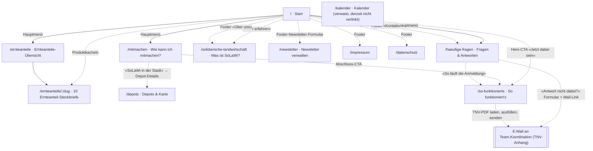
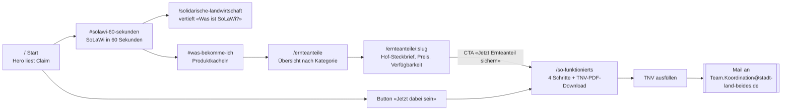
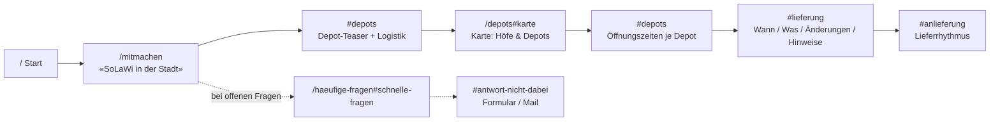
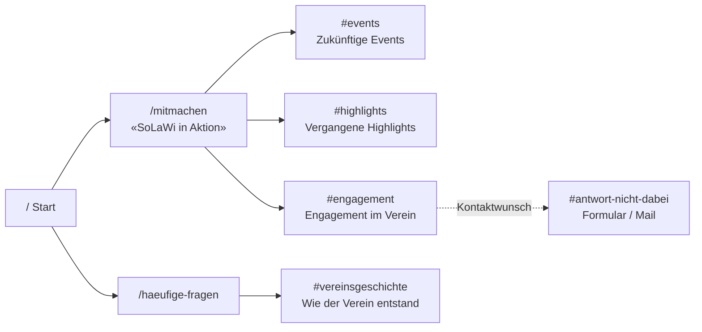
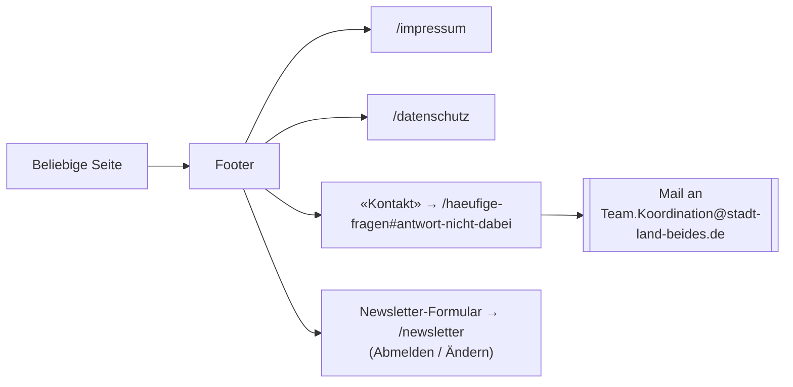

# Informationsstruktur

Dieses Dokument bildet die Informationsarchitektur des Prototyps ab: welche Seiten es
gibt, wie sie miteinander verlinkt sind, und welche Wege typische Besucher*innen durch
die Seite nehmen. Grundlage sind `src/app/routes.tsx`, `src/app/components/Navigation.tsx`,
`src/app/components/Footer.tsx` und die Purpose-Beschreibungen in `openspec/specs/`.

Ergänzend zu den Routen-/Capability-Zuordnungen in [`docs/seiten-katalog.md`](./seiten-katalog.md)
zeigt dieses Dokument die **Navigationswege** – wie man von A nach B kommt, nicht nur, was
auf jeder Seite steht.

## Gesamtstruktur (Sitemap)

Durchgezogene Pfeile sind Hauptmenü-Links, gestrichelte Pfeile sind Footer- oder
Inline-Links innerhalb von Seiteninhalten.

**Hauptmenü (3 Ebenen):** Start · Ernteanteile (nach Kategorie: Gemüse, Pilze, Obst, Beeren,
Getreide, Eier, Fleisch) · Mitmachen (SoLaWi in Aktion / SoLaWi in der Stadt) · Fragen & Antworten.

**Nicht im Hauptmenü, aber erreichbar:** `/so-funktionierts`, `/solidarische-landwirtschaft`,
`/depots` (nur über `/mitmachen` bzw. Footer), `/newsletter` (nur über das Footer-Formular),
`/impressum`, `/datenschutz` (nur Footer). `/kalender` existiert als Route, hat aber aktuell
keinen eingehenden Link.

## Personas und ihre Wege

### 1. Interessent*in – noch kein Mitglied

**Ziel:** Verstehen, was SoLaWi ist, einen passenden Ernteanteil finden und Mitglied werden.

Alternative Einstiege ins gleiche Ziel: Die FAQ-Sektion `#grundlagen` ("Wie kann ich
Ernteteiler werden?") verweist ebenfalls auf `/so-funktionierts`; wer vorher Rückfragen hat,
landet über `#antwort-nicht-dabei` (Formular + direkte Ansprechpartner) bei einer Beratung,
bevor die TNV verschickt wird.

### 2. Bestehende*r Ernteteiler*in – braucht Praxisinfos

**Ziel:** Wissen, wo/wann das eigene Depot öffnet, was bei Änderungen zu tun ist.

### 3. Engagement-Interessierte*r – will sich einbringen

**Ziel:** Events finden, Ehrenamt im Verein, Vereinsgeschichte verstehen.

### 4. Allgemeine*r Besucher*in / Presse – sucht rechtliche oder formale Infos

**Ziel:** Impressum, Datenschutz, Ansprechpartner oder Vereinsdaten finden — meist über
den Footer, unabhängig von der aktuell geöffneten Seite.

## Beobachtungen

- `/kalender` ist als Route vorhanden, wird aber derzeit von keiner Seite aus verlinkt
  (toter Einstieg, kein Besucher erreicht ihn über die UI).
- Es gibt keinen eigenständigen `/anmeldung`- oder `/kontakt-anmeldung`-Pfad mehr (siehe
  `openspec/changes/kontakt-newsletter-neu-ordnen/`): Der reale Anmeldeweg führt immer über
  TNV-Download auf `/so-funktionierts` und eine E-Mail, nicht über ein Webformular.

### Behoben (2026-10-24)

- **Veraltetes PDF:** Der Download-Button auf `/so-funktionierts` verlinkte noch auf
  `TNV_StadtLandBeides_V9_3_2026.pdf`, während die aktuelle Datengrundlage
  (`src/app/data/ernteanteile.ts`, Change `update-hoefe-tnv-v26-4`) bereits
  `TNV_StadtLandBeides_V26_4.pdf` nutzt. Link korrigiert.
- **Sackgasse Ernteanteil-Detailseiten:** Die zehn Hof-Steckbriefseiten hatten keinen
  Link oder CTA. Jede Seite bekommt jetzt am Fuß einen Button "Jetzt Ernteanteil
  sichern" → `/so-funktionierts`.
- **Kaputter Anker:** Der Link "Teilnahmebedingungen" auf `/so-funktionierts` zeigte auf
  `/mitmachen#teilnahme`, den es nicht gab. `Mitmachen.tsx` hat jetzt
  `id="teilnahme"` auf dem Abschluss-Abschnitt "Bereit mitzumachen?", auf den der Link
  zeigt.
